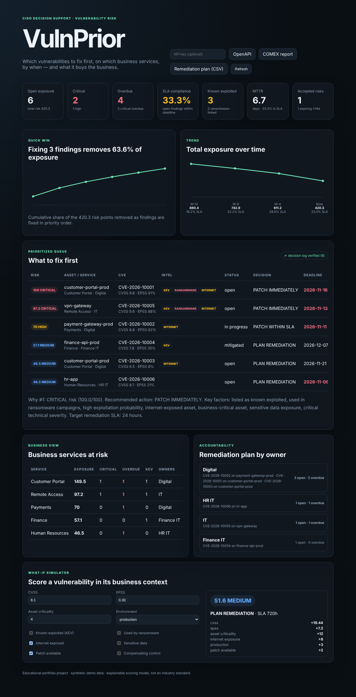

# VulnPrior

**Business-oriented vulnerability prioritization for CISO decision-making: CVSS + EPSS + CISA KEV / ransomware intelligence + asset criticality, SLA governance, four-eyes risk acceptance, Pareto impact analysis and executive reporting.**

Instead of asking only:

> Which CVEs have the highest CVSS score?

VulnPrior asks:

> Which vulnerabilities should we fix first, on which business services, by when, who is accountable — and how much risk does each fix remove?



## What's new in v2.0

| Capability | v1 | v2 |
|---|---|---|
| Threat intelligence | manual EPSS / KEV flags | **Live enrichment from FIRST EPSS and CISA KEV** (online or offline file), ransomware-use flag |
| Scoring | 9 factors | + ransomware factor, **configurable weights**, public methodology endpoint |
| SLA | due date recalculated on every rescore | **Deadline anchored on detection date**, overdue tracking, SLA compliance rate |
| Remediation workflow | free-text status | **Guarded lifecycle**: open → in progress → mitigated → remediated, false positive, regression re-open |
| Risk acceptance | — | **Four-eyes, time-bound**, max 30 days for known-exploited CVEs, auto-expiry back to the queue |
| Business view | — | Exposure **by business service**, **remediation plan by owner** (CSV for Jira / ServiceNow) |
| Decision support | — | **Pareto analysis** ("fixing N findings removes X% of exposure"), interactive what-if simulator |
| Metrics | counts | MTTR, % remediated within SLA, trend snapshots |
| Scanner import | assets / CVEs only | **Findings CSV import** with regression detection |
| Security & evidence | open API | API-key RBAC, security headers, **SHA-256 hash-chained decision log** |
| Reporting | dashboard | + **COMEX executive report** |
| Tests | 6 | **19** |

## Risk model

| Factor | Max impact (default) |
|---|---:|
| CVSS | 24 |
| EPSS (exploitation probability, 30 days) | 24 |
| Listed in CISA KEV (exploited in the wild) | 18 |
| Known ransomware campaign use | 6 |
| Asset criticality (1-5) | 16 |
| Internet exposure | 8 |
| Sensitive data | 5 |
| Production environment | 3 |
| Patch available | 2 |
| Compensating control | −12 |

Score clamped to 0-100. Bands: **CRITICAL ≥ 80**, HIGH ≥ 60, MEDIUM ≥ 35, LOW < 35. SLAs: 24h for a KEV on an internet-exposed asset, then 48h / 7d / 30d / 90d. All weights and SLAs are environment variables; `GET /api/v1/dashboard/methodology` publishes the model so it can be reviewed by an auditor or a risk committee.

> Educational, explainable model — not an industry standard and not a substitute for a vulnerability-management process.

## Remediation governance

```text
          ┌──────────── re-detected by scanner ─────────────┐
          ▼                                                  │
open ─► in_progress ─► mitigated* ─► remediated ─────────────┘
  │          │                          ▲
  ├──────────┴─► risk_accepted** ───────┘ (auto-returns to open on expiry)
  └─► false_positive*** ─► open

*   requires a documented compensating control (score reduced, not zeroed)
**  requires reason + approver ≠ requester, max 180 days (30 days if KEV)
*** requires a technical justification
```

Every transition is written to the hash-chained audit log; `GET /api/v1/audit/verify` proves nothing was altered.

## Quick start

```bash
python3 -m venv .venv && source .venv/bin/activate     # Windows: py -m venv .venv ; .\.venv\Scripts\Activate.ps1
pip install -r requirements.txt
python scripts/seed_demo.py
uvicorn app.main:app --reload
```

- Dashboard: `http://127.0.0.1:8000` (Pareto chart, trend, prioritized queue, business services, plan by owner, what-if simulator)
- OpenAPI: `http://127.0.0.1:8000/docs`
- COMEX report: `http://127.0.0.1:8000/api/v1/reports/executive`

The demo backlog is synthetic (CVE-2026-1xxxx) and works offline: overdue critical findings, ransomware-linked KEVs, a mitigated finding, a risk acceptance about to expire, remediated findings for MTTR and a 12-week trend.

### Docker

```bash
docker compose up --build
docker compose exec api python scripts/seed_demo.py
```

## Threat-intelligence enrichment

```bash
# Online: refresh EPSS for every CVE, flag CISA KEV entries (incl. ransomware use) and re-score
curl -X POST localhost:8000/api/v1/enrichment/epss
curl -X POST localhost:8000/api/v1/enrichment/kev

# Offline / air-gapped: upload the KEV JSON or supply EPSS values
curl -X POST localhost:8000/api/v1/enrichment/kev-file -F "file=@data/kev_sample.json"
curl -X POST localhost:8000/api/v1/enrichment/epss -H "Content-Type: application/json" \
  -d '{"scores": {"CVE-2026-10003": 0.42}}'
```

To try live data, import `data/sample_scan_real_cves.csv` (Log4Shell, MOVEit, BlueKeep, FortiOS, PAN-OS) and run the two online calls.

## API tour

```bash
curl localhost:8000/api/v1/dashboard/summary                 # exposure, SLA compliance, MTTR, KEV, ransomware
curl localhost:8000/api/v1/dashboard/business-services       # exposure by business service
curl "localhost:8000/api/v1/dashboard/remediation-impact?top=5"
curl "localhost:8000/api/v1/findings?overdue_only=true"
curl "localhost:8000/api/v1/findings?owner=Digital&level=CRITICAL"

# Workflow
curl -X POST localhost:8000/api/v1/findings/6/status -H "Content-Type: application/json" \
  -d '{"status":"in_progress","actor":"secops@demo.local"}'
curl -X PATCH localhost:8000/api/v1/findings/6 -H "Content-Type: application/json" \
  -d '{"ticket_ref":"SEC-2001","compensating_control":"WAF virtual patch"}'
curl -X POST localhost:8000/api/v1/findings/5/status -H "Content-Type: application/json" -d '{
  "status":"risk_accepted","actor":"secops@demo.local","approved_by":"cio@demo.local",
  "reason":"Vendor fix breaks checkout, hotfix expected","accepted_until":"2027-01-15T00:00:00Z"}'

# Scanner export (asset, cve_id, title, cvss, epss, kev, patch_available)
curl -X POST localhost:8000/api/v1/imports/findings-csv -F "file=@data/sample_scan_real_cves.csv"

# Reporting and evidence
curl localhost:8000/api/v1/reports/executive
curl -OJ "localhost:8000/api/v1/reports/remediation-plan?format=csv"
curl -X POST "localhost:8000/api/v1/dashboard/snapshots?label=Week-47"
curl localhost:8000/api/v1/audit/verify
```

## Security model

`API_KEYS="key1:admin,key2:reviewer,key3:auditor"` — **admin**: inventory, imports, enrichment, rescoring · **reviewer**: remediation workflow and risk acceptance · **auditor**: read-only, reports and audit. Empty = demo mode.

## Run tests

```bash
python -m pytest -q      # 19 passed
```

## Production limitations

SSO/OIDC instead of API keys, Alembic migrations, scheduled enrichment and snapshots, scanner connectors (Tenable, Qualys, Defender, Trivy), ticketing integration, WORM storage for the audit chain, rate limiting. Do not load real vulnerability data of an organization into a public demo.

## Interview talking point

> A CVSS 9.8 on a lab server is not my first priority; a CVSS 7.5 actively exploited by ransomware on our internet-facing payment service is. VulnPrior makes that reasoning explicit and auditable: it enriches CVEs with real threat intelligence, applies business context, holds owners to SLAs anchored on detection, keeps every risk acceptance time-bound and four-eyes, and tells the COMEX what share of our exposure the next sprint will remove.

## License

MIT — see `LICENSE`.
